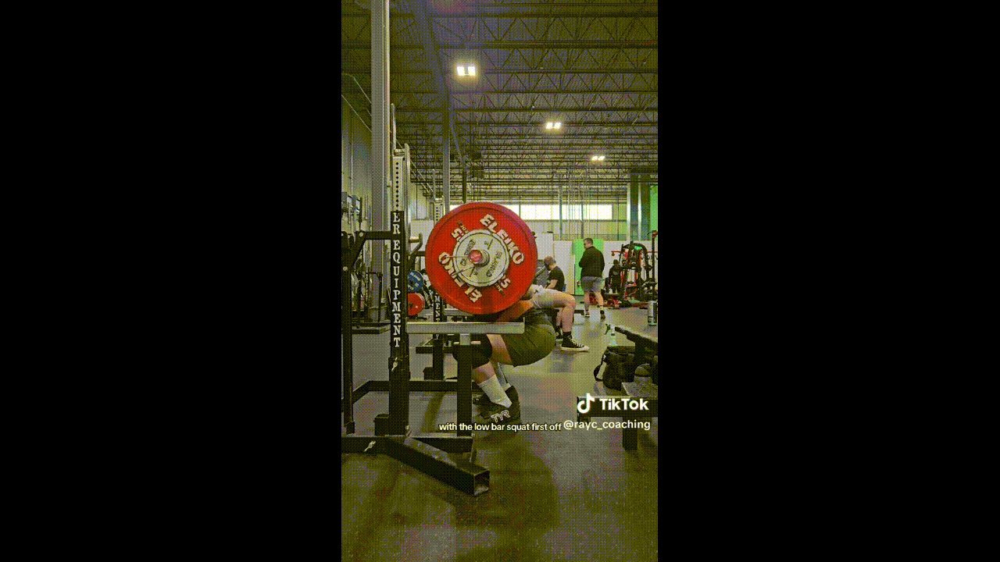
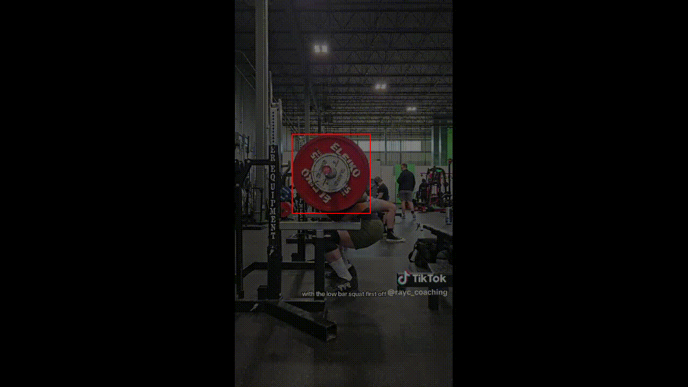
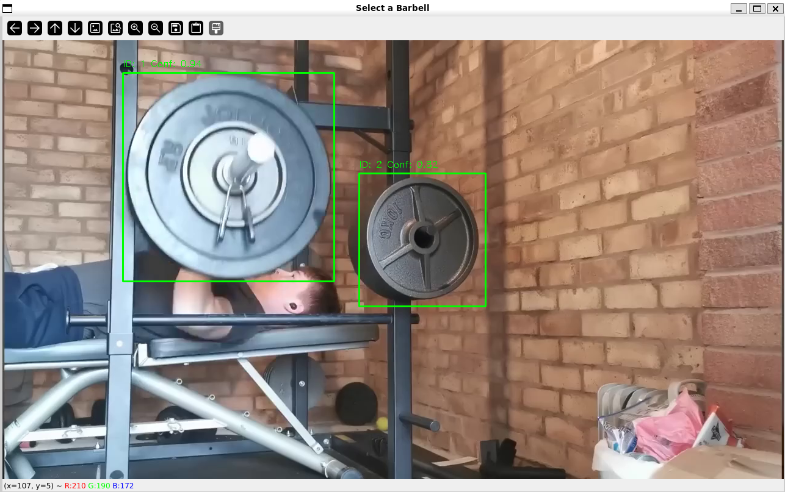

# Barbell Detection & Tracking System

A lightweight YOLOv8n-based barbell detection and tracking system optimized for mobile devices. This project uses a fine-tuned YOLOv8 nano model to detect and track weightlifting barbells in video footage, with support for path visualization and TFLite export for mobile deployment.

## Features

- **Custom YOLOv8n Model**: Fine-tuned on manually labeled barbell dataset using Roboflow
- **Multi-Barbell Selection**: Interactive selection when multiple barbells are detected
- **Path Visualization**: Draws barbell trajectory with motion trails
- **Mobile-Optimized**: Small model size (320×320 input) for low-spec mobile devices
- **TFLite Export**: Convert model to TensorFlow Lite format for mobile deployment
- **Performance Comparison**: Built-in tools to compare PyTorch vs TFLite inference speed

## Demo

**Input Video:**


**Output Video with Tracking:**


**Barbell Selection**


## Requirements

```bash
pip install ultralytics opencv-python numpy pillow torch pyyaml tensorflow
```

## Usage

### 1. Train the Model

Train a YOLOv8n model on your barbell dataset:

```python
python model.py
```

**Configuration:**
- Epochs: 30
- Image size: 320×320 (optimized for mobile)
- Batch size: 8 (auto-adjusted for CPU)
- Early stopping patience: 8 epochs
- Automatic GPU detection

The trained model will be saved as `barbell_detector.pt` in the `runs/detect/barbell_detector` directory.

### 2. Process Video with Tracking

Process a video with barbell detection and path visualization:

```python
python visualize_model.py
```

**Features:**
- **Interactive Selection**: If multiple barbells are detected, click on the one you want to track
- **Motion Trail**: Visualizes barbell path with fading effect (default: 15 frames)
- **Adjustable FPS**: Set target frame rate for output video (default: 25 fps)
- **Real-time Tracking**: Uses YOLO's built-in tracking algorithm

**Configuration in `visualize_model.py`:**
```python
model_path = "best.pt"           # Path to trained model
video_path = "test_video/video.mp4"  # Input video
output_video = "output/output_video.mp4"  # Output path
target_fps = 25                  # Output video FPS
trail_length = 15                # Number of trail dots
```

### 3. Export to TFLite

Convert the model for mobile deployment:

```python
python convert.py
```

This creates a TensorFlow Lite model at `best_saved_model/best_float32.tflite` optimized for mobile devices.

### 4. Compare Model Performance

Compare inference speed between PyTorch and TFLite versions:

```python
python compare_models.py
```

**Output includes:**
- Detection count
- Bounding box coordinates
- Confidence scores
- Inference time comparison
- Speed ratio between formats

## Model Details

### Training Configuration
- **Base Model**: YOLOv8n (nano variant)
- **Input Size**: 320×320 pixels
- **Original Dataset**: 720×900 frames
- **Dataset**: Manually labeled using Roboflow
- **Classes**: 1 (barbell)
- **Training Device**: Automatic GPU/CPU detection

### Model Performance
The model is optimized for:
- Low-specification mobile devices
- Real-time inference (25+ fps on mobile)
- Accurate barbell detection in various lighting conditions
- Tracking through occlusions

## Data Format

The `data.yaml` file should follow this structure:

```yaml
train: path/to/train/images
val: path/to/val/images
nc: 1
names: ['barbell']
```

## How It Works

1. **Training** (`model.py`): 
   - Loads pre-trained YOLOv8n weights
   - Fine-tunes on barbell dataset
   - Validates and exports the model

2. **Selection** (`visualize_model.py`):
   - Detects all barbells in the first frame
   - Displays interactive selection UI
   - User clicks on desired barbell to track

3. **Tracking** (`visualize_model.py`):
   - Uses YOLO's built-in tracking algorithm
   - Maintains barbell ID across frames
   - Draws bounding box and motion trail

4. **Export** (`convert.py`):
   - Converts PyTorch model to TFLite
   - Optimizes for mobile inference
   - Maintains detection accuracy

## Output Format

The processed video includes:
- **Red bounding box** around tracked barbell
- **Motion trail** showing barbell path (fading effect)
- **Dots** at center points with alpha blending
- **Frame rate** as specified in configuration

## Performance Tips

- **GPU Training**: Automatically uses GPU if available (5-10x faster)
- **Batch Size**: Auto-adjusts for CPU (max 4) to prevent memory issues
- **Image Size**: 320×320 provides best balance of speed and accuracy for mobile
- **Trail Length**: Reduce for better performance, increase for longer visualization

## Troubleshooting

**No barbells detected:**
- Check video quality and lighting
- Ensure barbell is clearly visible in frame
- Try adjusting confidence threshold in code

**Slow processing:**
- Reduce `target_fps` parameter
- Use smaller `trail_length`
- Ensure GPU is being utilized for inference


## Acknowledgments

- **YOLOv8** by Ultralytics for the base detection framework
- **Roboflow** for dataset labeling and management

## Contact

For questions or contributions, please open an issue or submit a pull request.
